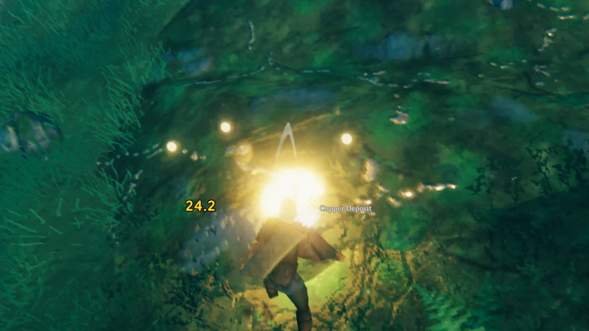

# Ore Weak Spots

**[English](#english) · [Português](#português)**

---

## English

Mining with a bit of aim. When you aim at a rock or ore deposit with a pickaxe, small glowing orbs appear on its surface. Hit one and your swing becomes a **critical hit**: double damage by default, with a flash, a sound and a big yellow damage number.

### Features

- **Client-side only.** The server and other players don't need the mod.
- Weak spots fade in, pulse, fade out and reappear somewhere else on the rock every few seconds.
- They spread over the whole visible surface of the rock and keep a minimum distance from each other.
- Works on every rock and ore deposit. Tin is left out because its deposits are too small.
- Crit hits show a yellow damage number twice the normal size.

### Requirements

- [BepInExPack Valheim](https://thunderstore.io/c/valheim/p/denikson/BepInExPack_Valheim/)

### Installation

**r2modman / Thunderstore Mod Manager:** click *Install*. To install a downloaded zip, go to Settings → *Import local mod*.

**Nexus Mods / Vortex:** also on [Nexus Mods](https://www.nexusmods.com/valheim/mods/4895).

**Manual:**
1. Extract the zip.
2. Copy the `plugins/OreWeakSpots` folder into `Valheim/BepInEx/plugins/`.
   You should end up with `Valheim/BepInEx/plugins/OreWeakSpots/OreWeakSpots.dll`.
3. Launch the game.

To update, delete the old `OreWeakSpots` folder before copying the new one.

### Configuration

Press **F1** in game (needs Configuration Manager) or edit `BepInEx/config/felih.OreWeakSpots.cfg`.

| Option | Default | What it does |
|---|---|---|
| Enabled | on | Turns the mod on or off. |
| CritMultiplier | 2 | Damage multiplier when you hit a weak spot. |
| CritUsesMidDamage | on | A crit uses the middle of your skill's damage range instead of the game's random roll, so crits are never weak. |
| AllRocks | on | Weak spots on every rock, not only on ore. |
| OreNames | copper, silver… | Names that count as ore when AllRocks is off. |
| Exclude | tin | Rocks that never get weak spots. |
| Count | 4 | Weak spots at the same time (1–8). |
| MinSpacing | 1.2 m | Minimum distance between weak spots. |
| HitTolerance | 0.6 m | How close to a weak spot the swing must land. |
| SpotLifetime | 5 s | Time before a weak spot moves. |
| MaxDistance | 8 m | How far from your eyes weak spots can appear. |
| IdleTimeout | 3 s | Time without aiming before the weak spots disappear. |
| Color | Gold | Gold or Blue. |
| Size | 1 | Size of the orbs. |
| SoundVolume | 1 | Crit sound volume (0 = off). |
| CritSound | Auto | Auto, File, Game, Mod or None. |
| CritNumberColor | Yellow | Crit damage number color: Yellow, Red or Normal. |
| CritNumberSize | 2 | Crit damage number size (2 = double, 1 = unchanged). |
| DetailedLog | off | Writes every hit to the BepInEx log, for troubleshooting. |

### Custom crit sound

Drop `.wav` or `.ogg` files into `BepInEx/plugins/OreWeakSpots/SFX`. With `CritSound` set to `Auto` or `File`, one of them plays at random on each crit. Without files, the mod uses the game's own sound for hitting a staggered enemy.

### Bugs & suggestions

Found a bug or have an idea? Open an [issue](https://github.com/Felihens/OreWeakSpots/issues) or start a [discussion](https://github.com/Felihens/OreWeakSpots/discussions) on GitHub.

### Notes

- ImpactfulSkills has its own random mining crit. Those crits come from ImpactfulSkills, not from this mod.
- On servers with rules or anti-cheat, check with the owner first: this mod increases your pickaxe damage.
- Sister mod: **Tree Weak Spots** does the same for chopping fallen logs.

---

## Português

Mineração com um pouco de mira. Ao mirar numa pedra ou depósito de minério com a picareta, pequenas esferas de luz aparecem na superfície. Acerte uma e o golpe vira um **crítico**: dano dobrado por padrão, com clarão, som e um número de dano grande e amarelo.

### O que o mod faz

- **Só no seu jogo.** O servidor e os outros jogadores não precisam ter o mod.
- As esferas surgem aos poucos, pulsam, somem e reaparecem em outro ponto da pedra a cada poucos segundos.
- Elas se espalham por toda a parte visível da pedra, com uma distância mínima entre si.
- Funciona em todas as pedras e minérios. O estanho fica de fora porque os depósitos são pequenos demais.
- O número de dano do crítico aparece amarelo e com o dobro do tamanho.

### Requisitos

- [BepInExPack Valheim](https://thunderstore.io/c/valheim/p/denikson/BepInExPack_Valheim/)

### Instalação

**r2modman / Thunderstore Mod Manager:** clique em *Install*. Para instalar um zip baixado, vá em Configurações → *Import local mod*.

**Nexus Mods / Vortex:** também está no [Nexus Mods](https://www.nexusmods.com/valheim/mods/4895).

**Manual:**
1. Extraia o zip.
2. Copie a pasta `plugins/OreWeakSpots` para dentro de `Valheim/BepInEx/plugins/`.
   O resultado deve ser `Valheim/BepInEx/plugins/OreWeakSpots/OreWeakSpots.dll`.
3. Abra o jogo.

Para atualizar, apague a pasta `OreWeakSpots` antiga antes de copiar a nova.

### Configuração

Aperte **F1** no jogo (precisa do Configuration Manager) ou edite `BepInEx/config/felih.OreWeakSpots.cfg`. Os nomes das opções ficam em inglês:

| Opção | Padrão | O que faz |
|---|---|---|
| Enabled | ligado | Liga ou desliga o mod. |
| CritMultiplier | 2 | Multiplicador do dano ao acertar uma esfera. |
| CritUsesMidDamage | ligado | O crítico usa o meio da faixa de dano da sua habilidade em vez do sorteio do jogo, então ele nunca sai fraco. |
| AllRocks | ligado | Esferas em qualquer pedra, não só em minério. |
| OreNames | copper, silver… | Nomes que contam como minério quando AllRocks está desligado. |
| Exclude | tin | Pedras que nunca recebem esferas. |
| Count | 4 | Esferas ao mesmo tempo (1 a 8). |
| MinSpacing | 1,2 m | Distância mínima entre as esferas. |
| HitTolerance | 0,6 m | Quão perto da esfera o golpe precisa cair. |
| SpotLifetime | 5 s | Tempo até a esfera mudar de lugar. |
| MaxDistance | 8 m | Até que distância dos olhos as esferas aparecem. |
| IdleTimeout | 3 s | Tempo sem mirar até as esferas sumirem. |
| Color | Gold | Gold (dourado) ou Blue (azul). |
| Size | 1 | Tamanho das esferas. |
| SoundVolume | 1 | Volume do som do crítico (0 desliga). |
| CritSound | Auto | Auto, File (arquivo), Game (jogo), Mod ou None (nenhum). |
| CritNumberColor | Yellow | Cor do número do crítico: Yellow (amarelo), Red (vermelho) ou Normal. |
| CritNumberSize | 2 | Tamanho do número do crítico (2 = o dobro, 1 = sem mudança). |
| DetailedLog | desligado | Registra cada golpe no log do BepInEx, para investigar problemas. |

### Som próprio para o crítico

Coloque arquivos `.wav` ou `.ogg` na pasta `BepInEx/plugins/OreWeakSpots/SFX`. Com `CritSound` em `Auto` ou `File`, o mod toca um deles ao acaso a cada crítico. Sem arquivos, ele usa o som do próprio jogo ao acertar um inimigo atordoado.

### Bugs e sugestões

Achou um bug ou tem uma ideia? Abra uma [issue](https://github.com/Felihens/OreWeakSpots/issues) ou comece uma [discussão](https://github.com/Felihens/OreWeakSpots/discussions) no GitHub.

### Observações

- O ImpactfulSkills tem um crítico aleatório próprio na mineração. Esses críticos são dele, não deste mod.
- Em servidores com regras ou anti-cheat, fale com o dono antes: o mod aumenta o dano da sua picareta.
- Mod irmão: o **Tree Weak Spots** faz o mesmo no corte de troncos caídos.
